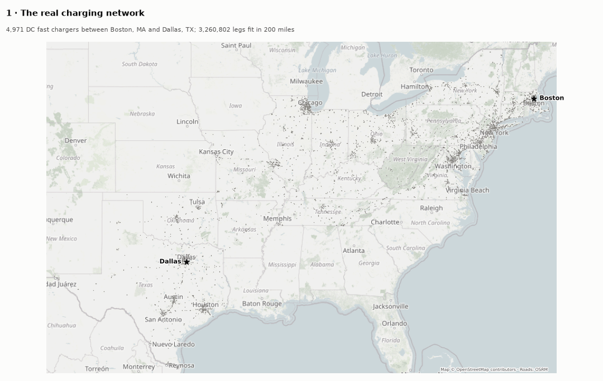
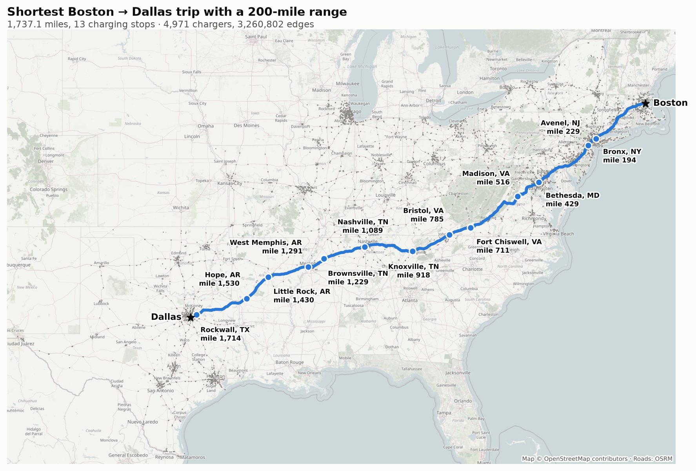
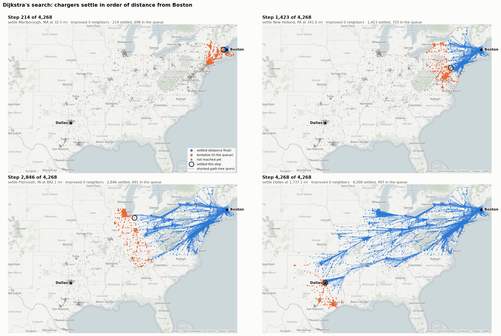
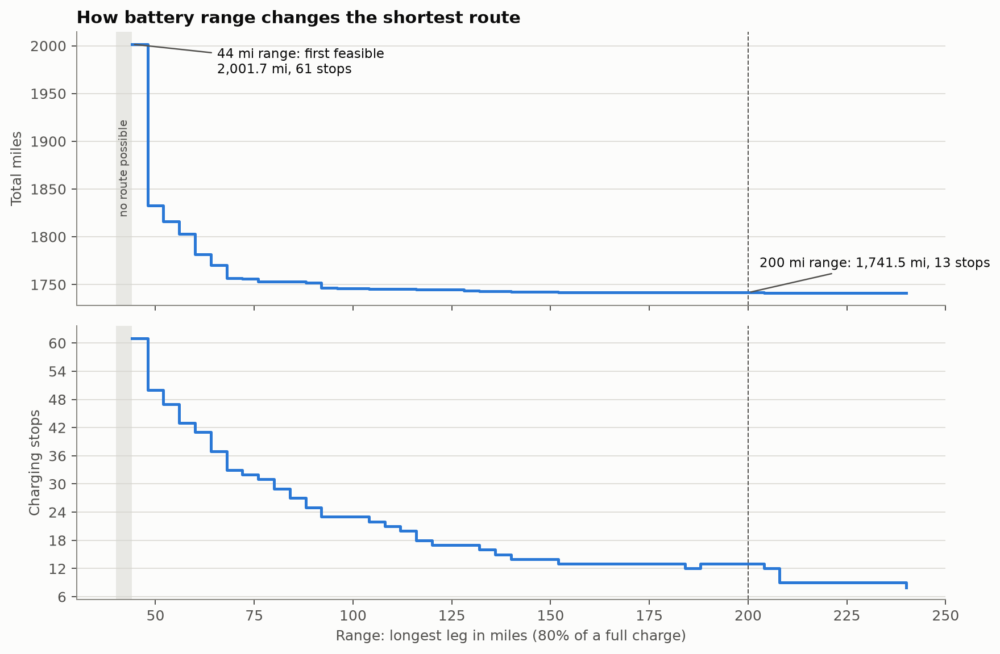
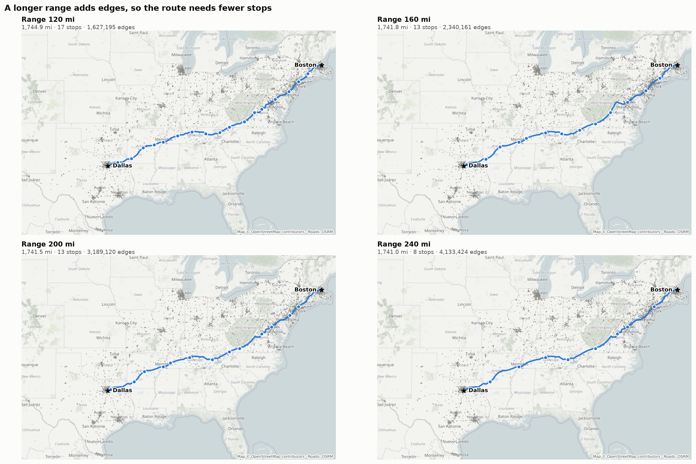
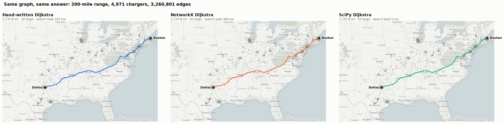
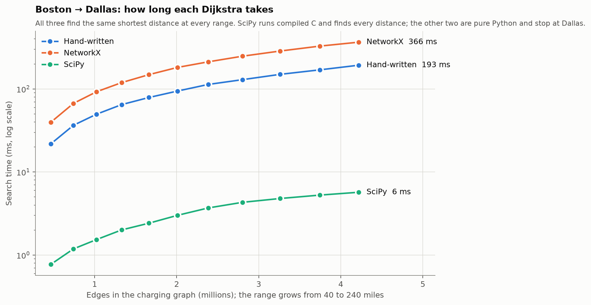
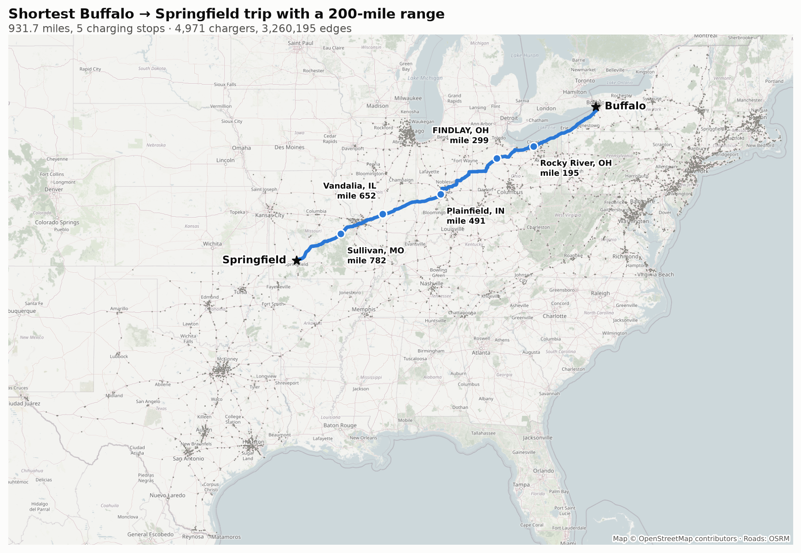
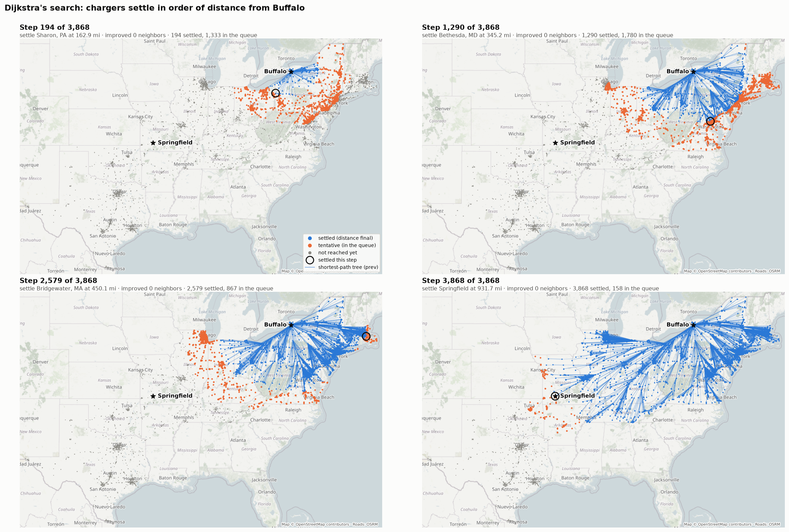

# Dallas → Boston in an EV: Dijkstra on a range-limited graph

**Question.** An electric car drives from Dallas to Boston. Which DC fast chargers should it
stop at so that the total distance is as short as possible? The catch is the limited range:
the car cannot drive directly between every pair of chargers.



## Run it

This folder runs on the real charger network built at the repository root, so it uses the
root `.venv` and `data/` (see the root README: `charger_graph.py` builds `data/`).

```bash
../.venv/bin/python main.py               # analysis + all figures
../.venv/bin/python main.py --show        # also play the search live in a window
../.venv/bin/python main.py --range 240   # another range (default 200, up to 240)
../.venv/bin/python main.py --start "Buffalo, NY" --end "Springfield, MO"   # another trip
../.venv/bin/python trip_table.py         # slide table: search time and work per trip
../.venv/bin/python astar_table.py        # slide table: Dijkstra vs A* (two heuristics)
```

Or run everything in one go: `./run_all.sh` (add `--quick` to skip `main.py`). It runs
`runtime.py`, `main.py` and `compare_library.py`, then opens the web demo and the figures.

**Web demo.** Open `dijkstra-demo.html` in any browser (no install, works offline). It replays
Dijkstra one line of code at a time, highlighting the line next to the map, the waitlist and
the distance table, and compares the real runtime with the slowed-down animation.
The source is in `web/` (TypeScript + React): `npm install`, then `npm run dev` to develop
or `npm run build:single` to rebuild `dijkstra-demo.html`.

**Runtime.** `../.venv/bin/python runtime.py` times a minimal Dijkstra on the real trip and on
random graphs from 1k to 64k nodes, and saves `figures/runtime.png`.

`main.py` prints Dijkstra's progress, the best route, and how the answer changes with range,
then writes the figures to `figures/`. The first run of a trip builds its network from `data/`
(about a minute) and caches it in `cache/` (`cache/network.pkl` for Dallas → Boston); it also
downloads the map tiles and the road shapes it draws. Later runs take about 15 seconds and
work offline. Figures for another trip get its name, e.g. `figures/route_buffalo_springfield.png`.

| File | What it does |
|---|---|
| `network.py` | loads the real network for a trip: every DC fast charger in the 17 states, and the road miles between them |
| `realmap.py` | fetches the map for the figures: OpenStreetMap tiles, and road shapes from OSRM |
| `dijkstra.py` | Dijkstra's algorithm, path traceback, and the range-limited charging graph |
| `hand.py` | our hand-written Dijkstra and A*, run on the same network |
| `visualize.py` | every figure, including the animation of the search on the map |
| `main.py` | runs the analysis and makes the figures |
| `runtime.py` | minimal Dijkstra plus a runtime function, timed on growing graphs |
| `compare_library.py` | our hand-written Dijkstra against NetworkX's and SciPy's at every range |
| `trip_table.py` | time, nodes expanded and edges checked for Dallas → Boston and Buffalo → Springfield |
| `astar_table.py` | Dijkstra against A* with a Haversine and a scaled Manhattan guess, same two trips |
| `web/` | TypeScript + React step-by-step demo; built into `dijkstra-demo.html` |
| `run_all.sh` | runs everything above and opens the demo |

## Data

- **Chargers.** Every public DC fast charger in the 17 states between Dallas and Boston,
  from the Department of Energy's station list (6,162 stations). Each is matched to its
  nearest road intersection; stations at the same intersection are merged, which leaves
  **4,971 charger locations**.
- **Distances.** Road miles between every two chargers at most 240 miles apart, measured on
  OpenStreetMap roads (4,218,013 legs). Each leg includes the short detour from the road to
  the charger at both ends. Roads can be one-way, so A → B and B → A can differ and the
  graph is **directed**. The start and end of a trip are joined to every charger within 240
  road miles.
- **Map.** OpenStreetMap tiles, muted so the data stands out. The roads drawn on top are the
  real routes from the OSRM route service. Map data © OpenStreetMap contributors.

## Model

**Range.** The range is the longest leg the car may drive on one charge. We only use 80% of
a full battery as a safety margin, so a Model Y's 250 miles gives a **200-mile range**. The
car is assumed to start with, and recharge to, those 200 miles at every stop.

**Nodes** are the start, the end, and the 4,971 chargers. There is an **edge A → B only if the
leg from A to B is at most the range**. Its **weight is the leg's miles**. The battery limit
lives in the structure of the graph, not in the algorithm. A leg can pass other chargers
without stopping. The data has legs up to 240 miles, so ranges up to 240 can be tested.

**Dijkstra.** Start at Dallas with distance 0. At each step, *settle* the unsettled charger
closest to Dallas. Its distance is now final. Then *relax* its edges: if going through it
gives a neighbor a shorter distance, update that neighbor and remember where it came from
(`prev`). Stop when Boston is settled, then follow `prev` back from Boston to get the route.

**Nodes expanded** is how many nodes Dijkstra settles before it reaches the end; **edges
checked** is how many edges it looks at while relaxing them. Both measure the search's work.

## Result for a 200-mile range

The charging graph has 4,973 nodes and 3,260,801 directed edges.
Dijkstra settles 4,817 of them before Boston. The best route:

| Leg | Miles |
|---|---|
| Dallas → Texarkana, TX | 175.5 |
| Texarkana → Benton, AR | 121.7 |
| Benton → Mason, TN | 196.1 |
| Mason → Nashville, TN | 175.9 |
| Nashville → Dandridge, TN | 197.9 |
| Dandridge → Abingdon, VA | 99.4 |
| Abingdon → Fincastle, VA | 135.6 |
| Fincastle → Vienna, VA | 192.5 |
| Vienna → Monmouth Junction, NJ | 193.6 |
| Monmouth Junction → North Haven, CT | 123.3 |
| North Haven → Boston | 126.4 |
| **Total (10 charging stops)** | **1,737.8** |



The route takes the southern corridor: I-30 out of Texas, I-40 across Arkansas and
Tennessee, I-81 up the Shenandoah Valley, then I-95 through New Jersey and into New England.
(The station list spells Benton, AR as "Bentoin", so the map uses that spelling.)

The graph is directed, so the trip the other way, Boston → Dallas, is a different search:
1,737.1 miles with 13 stops.

## The search, step by step

The animation at the top tells the story in three acts:

1. **The real network.** All 4,971 chargers.
2. **Dijkstra.** Each frame jumps ahead about 80 steps. Blue dots are settled (their distance
   is final), orange dots are waiting in the queue, gray dots are not reached yet, and the
   thin blue lines are the shortest-path tree (`prev`).
3. **Trace back** from Boston through `prev[]`, drawing each leg along the real roads.

The same steps as still images, for a printed report:



Dijkstra settles chargers in order of distance from Dallas, so the search spreads out like a
ripple in every direction: Chicago, Michigan and the whole Midwest are settled before Boston,
and they all end up off the final route. Boston sits in the far corner of the network, so
almost every charger is closer to Dallas than Boston is: Dijkstra settles 97% of the network
before it reaches Boston. A* (`hand.py`) aims toward Boston and settles 3,246 instead of
4,817, a third fewer.

## Varying the range



| Range (mi) | Total miles | Stops |
|---|---|---|
| 40 | — | — (no route) |
| 44 | 1,846.7 | 56 |
| 80 | 1,743.9 | 27 |
| 120 | 1,739.9 | 18 |
| 160 | 1,738.8 | 13 |
| 200 | 1,737.8 | 10 |
| 240 | 1,737.6 | 8 |



What the sweep shows:

1. **With real chargers, even a tiny range works.** Chargers are so dense that a 43-mile
   range already connects Dallas to Boston; at 44 miles the route needs 56 stops. Below 43
   miles some gap cannot be crossed. Finding that smallest workable range is a *bottleneck*
   (minimax) path problem, a cousin of the shortest-path problem.
2. **Total distance never gets worse as range grows.** A larger range only *adds* edges, and
   adding edges can never make a shortest path longer.
3. **Range mostly buys fewer stops, not fewer miles.** From a 120-mile range to 240 miles
   the trip gets only 2.3 miles shorter, but needs 10 fewer stops.
4. **Stops are not the objective.** Dijkstra only counts miles; stops fall because longer
   legs happen to need fewer of them. On Boston → Dallas a 188-mile range even gives one
   more stop than 184 miles, to save 0.07 miles. `trip.py` at the root instead puts fewest
   stops first.

## Hand-written vs library Dijkstra

`../.venv/bin/python compare_library.py` runs three Dijkstras on the same charging graph at
every range from 40 to 240 miles: ours (`dijkstra.py`), NetworkX's `single_source_dijkstra`
(pure Python) and SciPy's `csgraph.dijkstra` (compiled C). Only the search is timed.

| Range | Edges | Miles | Stops | Hand-written | NetworkX | SciPy |
|---|---|---|---|---|---|---|
| 80 | 1,022,729 | 1,743.9 | 27 | 54 ms | 96 ms | 1.5 ms |
| 160 | 2,385,773 | 1,738.8 | 13 | 128 ms | 226 ms | 3.5 ms |
| 200 | 3,260,801 | 1,737.8 | 10 | 167 ms | 304 ms | 4.6 ms |
| 240 | 4,219,576 | 1,737.6 | 8 | 213 ms | 389 ms | 5.7 ms |





- **Same answer.** At every range all three find the same distance and the same stops.
- **Ours beats NetworkX by about 1.8x.** Both are pure Python and stop at Boston, but NetworkX
  looks up each edge's weight in an attribute dictionary and handles general cases, while
  ours reads a plain number from `{node: {neighbor: miles}}`.
- **SciPy is about 35x faster than ours** even though it finds the distance to *every*
  charger, not just Boston: its loop runs in compiled C over arrays instead of Python dicts.
  The algorithm is the same; the constant factor is what differs.
- All three grow roughly in line with the number of edges, as O((V + E) log V) predicts.
  The 40-mile point is low because there is no route: the search runs out of reachable
  chargers after 871 of them and stops. Timings are the fastest of 3 runs on an Apple laptop.

## Second trip: Buffalo → Springfield, MO

The same network and the same 200-mile range, from Buffalo, NY to Springfield, MO:
**931.7 miles with 5 charging stops**, at Rocky River, OH (mile 195), Findlay, OH (299),
Plainfield, IN (491), Vandalia, IL (652) and Sullivan, MO (782).



The trip is half as long as Dallas → Boston, but the search does 80% as much work:
Dijkstra settles everything closer to Buffalo than Springfield is, so it covers New England
and Virginia, behind the start, before it reaches Missouri.



`trip_table.py` puts both trips side by side (200-mile range, median of 101 runs):

| Trip | Dijkstra | Median time (ms) | Nodes expanded | Edges checked |
|---|---|---|---|---|
| Dallas → Boston | Hand-written | 205.85 | 4,817 | 3,166,390 |
| Dallas → Boston | NetworkX | 366.38 | 4,817 | 3,166,390 |
| Dallas → Boston | SciPy | 4.03 | 4,973 | 3,260,801 |
| Buffalo → Springfield | Hand-written | 147.59 | 3,868 | 2,893,605 |

Ours and NetworkX do exactly the same work; ours is faster per edge. SciPy does not stop at
the end, so it settles every node and checks every edge, and is still the fastest. These
times are medians, so they run a little higher than the fastest-of-3 times above.

## Dijkstra vs A*

`astar_table.py` runs both trips again with A*, which adds a guess of the miles left to the
end, so it settles chargers toward the goal first. Two guesses: straight-line (Haversine)
miles, and north-south plus east-west (Manhattan) miles. Manhattan can overestimate a leg,
so it is scaled down until it never does (by 0.71 for Dallas → Boston, 0.70 for Buffalo →
Springfield); Haversine needs no scaling. All three find the same route on both trips.

| Trip | Algorithm | Expanded | Fewer than Dijkstra | Time |
|---|---|---|---|---|
| Dallas → Boston | Dijkstra | 4,817 | – | 169 ms |
| Dallas → Boston | A* Haversine | 3,246 | 33% | 132 ms |
| Dallas → Boston | A* Scaled Manhattan | 4,177 | 13% | 166 ms |
| Buffalo → Springfield | Dijkstra | 3,868 | – | 143 ms |
| Buffalo → Springfield | A* Haversine | 740 | 81% | 19 ms |
| Buffalo → Springfield | A* Scaled Manhattan | 1,021 | 74% | 26 ms |

Haversine is the closer guess, so it always expands fewer nodes. A* helps far more on
Buffalo → Springfield: from Buffalo, Dijkstra first searches New England, behind the start,
which A* skips. From Dallas, Boston is in the far corner, so most of the network lies
roughly on the way and even A* has to settle it.

## Limitations

- The model assumes a full charge at every stop and a fixed range. In reality range drops
  with speed and cold weather. Using 80% of the battery (200 of 250 miles) is a simple
  safety margin.
- It minimizes distance, not travel time, and ignores charging time. The same algorithm
  works for time with a different edge weight.
- Every DC fast charger counts, whatever its network or plug type; a real car can only use
  the ones with a compatible plug.
